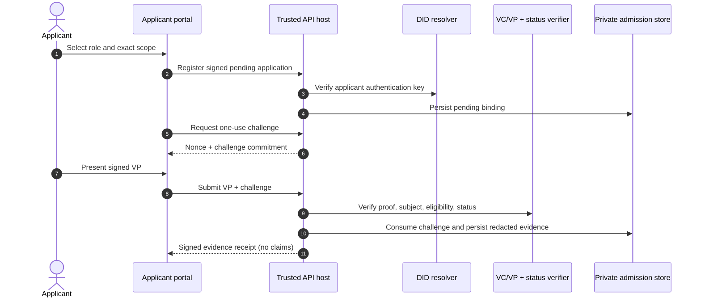
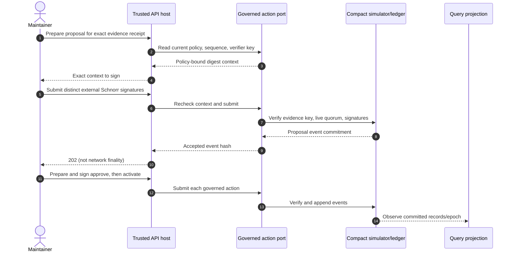
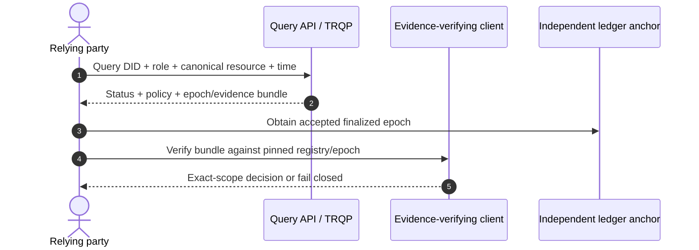

# Protocol sequences

These diagrams distinguish a **reference simulator flow** from a production network transaction. The trusted embedding host owns private VP intake, DID/status checks, and Compact submission; the packaged CLI does not supply these ports.

## Apply with a Midnight VP

The private routes require applicant authorization, a real resolver, current policy binding, and atomic challenge consumption. Without the injected port they return `503`.

## Govern a scoped grant

The preimage is invalid if sequence, policy, scope, predecessor, or membership changes before submission. Proposal, authorization, and activation are distinct state transitions.

## Rely on a decision

For a VC, the relying party must also verify the VC signature, holder binding, and credential status. An old active bundle is not proof of current authorization.
