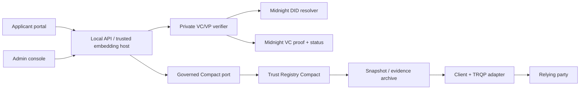

# Components and boundaries

The registry has two kinds of truth: **Compact ledger state** for governed commitments and **off-chain evidence/projections** for private proofs, readable queries, and operator workflows. A query service does not become an authority merely because it can serve a snapshot.

## Package map

| Component | Responsibility |
| --- | --- |
| `contracts/trust-registry` | Compact ledger records, governed circuits, signature/digest helpers and simulator tests |
| `packages/trust-registry-domain` | Types, canonical scope/ID hashing, lifecycle, policy and evidence validation |
| `packages/trust-registry-client` | Decision/evidence verification and historical evaluation helpers |
| `packages/trust-registry-integration` | DID/VC-aware simulator journeys |
| `packages/trust-registry-cli` | Local operator workspace and demo preparation |
| `packages/trust-registry-api` | HTTP query projection and optional trusted workflow ports |
| `packages/trust-registry-admin-console` | Local maintainer/operator UI |
| `packages/trust-registry-applicant-portal` | Local applicant UI |
| `adapters/trqp` | TRQP-compatible query/evidence representation |
| `adapters/openid-federation` | Federation metadata and entity-statement projection |

## Ownership rules

[`midnight-did`](https://midnightntwrk.github.io/midnight-did/) owns DID lifecycle, resolution, and keys. [`midnight-verifiable-credentials`](https://midnightntwrk.github.io/midnight-verifiable-credentials/) owns credential/presentation proof and status. The Trust Registry owns scoped authorization, recognition, governance, epochs, and decision evidence. Neither raw VP claims nor holder activity should cross into public registry state.

The packaged API is file-backed and local-first. It serves snapshots/workspaces; it does not install a production DID resolver, signing service, distributed lock, or network-backed Compact submission port. Embedded hosts can provide trusted ports for private intake and governed actions. See [API safety](../api/index.md).
