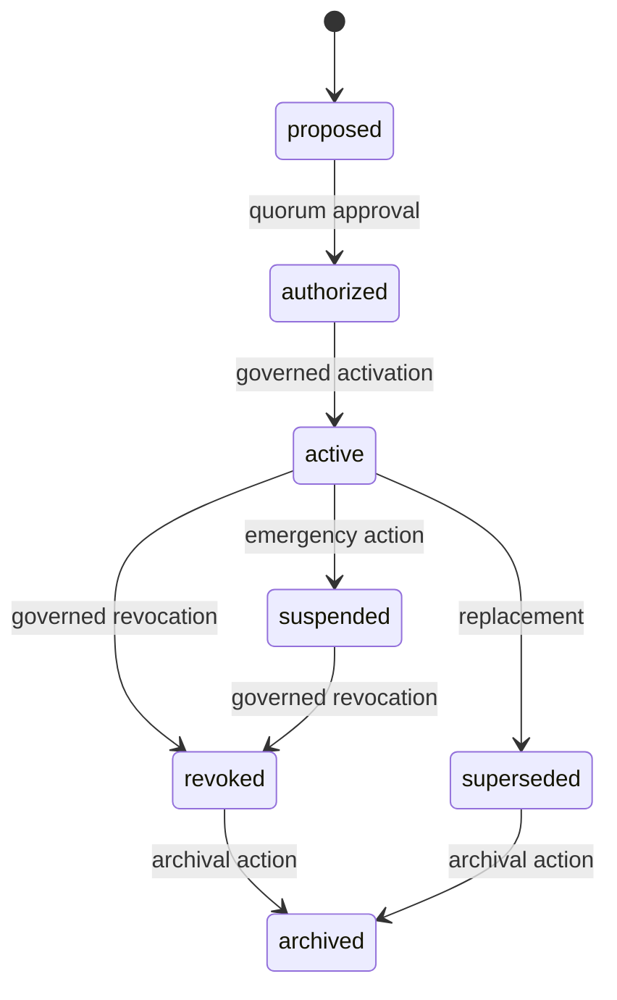

# Domain model

The key distinction is **identity versus authorization**. A DID identifies a party. A registry decision grants that party one role for one canonical resource under one policy and a bounded lifecycle. There is no global `trusted: true` bit.

## Core records

| Record | Meaning | Key fields and invariants |
| --- | --- | --- |
| Registry | Trust domain and operator identity | `registryId`, registry DID, policy and lifecycle |
| Governance policy | Versioned decision rules | Commitment, effective window, thresholds and policy family bindings |
| Maintainer membership | Governed voting right | Candidate DID/key, membership status, no self-vote |
| Application | Candidate's request for an exact role/scope | Applicant DID, nonce, evidence commitment, policy snapshot |
| Authorization | Local permission to issue, verify, or audit | Subject DID, role, canonical resource ID, lifecycle and policy |
| Recognition | Acceptance of an external authority for a scope | Authority DID, external registry, exact resource, evidence |
| Governance event | Append-only reason for a change | Action kind, signer-set hash, policy-bound payload and predecessor |
| Epoch commitment | Bounded published view | State/event/policy roots and observed sequence, not wall-clock time |
| Evidence bundle | Portable decision support | Grant/event/epoch inclusion plus signer and policy evidence |

## Exact scope

Issuer grants use a canonical tuple of credential family, schema ID/version, credential definition, and status method. Its resource ID has the shape `tr:issuer-resource:v1:<sha256>`. Verifier and auditor grants bind request-profile ID, purpose, credential-scope commitment, sorted attributes and predicates, and disclosure level. Their resource ID has the shape `tr:request-resource:v1:<sha256>`. A bare request-profile ID is rejected by the API. There are no wildcard grants or implicit version ranges in 0.1.0. See [scope canonicalization ADRs](https://github.com/midnightntwrk/midnight-trust-registry/tree/develop/docs/decisions).

## Lifecycle

The diagram is conceptual. Exact allowed transitions are validated by the domain and Compact circuits; a proposed rejection/terminal reuse rule remains an explicit 0.1.0 gap. Revocation and archival preserve history. `active` is the only state that grants current authorization; an older active evidence bundle is historical, not proof of current permission.

## Time and status

The contract has no trusted wall clock. It stores sequence/epoch commitments and policy-supplied effective values. A client interprets a timestamp using a trusted observation or finalized ledger view; it must not mistake an API clock for consensus time. See [evidence and time](./evidence.md).
